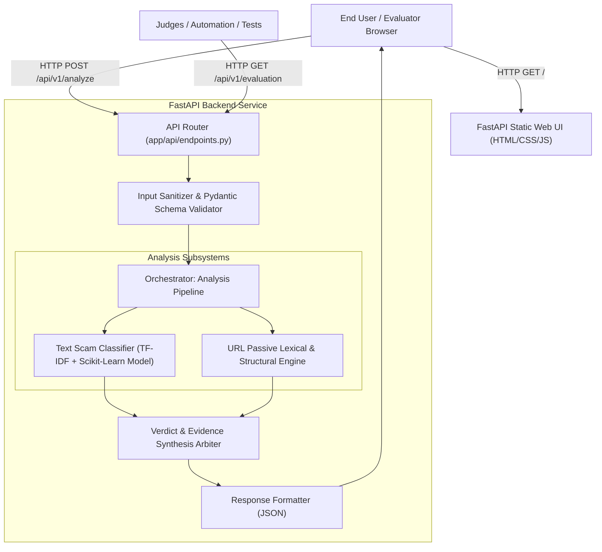
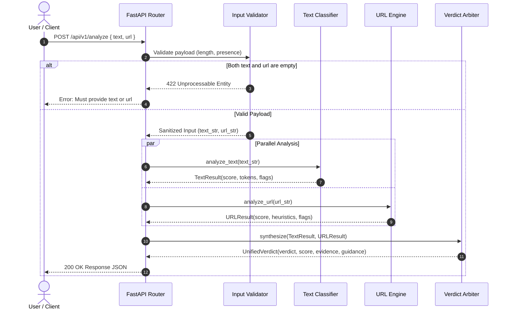
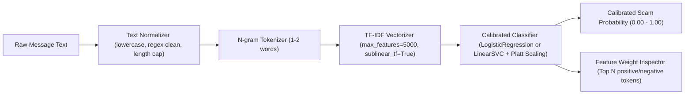
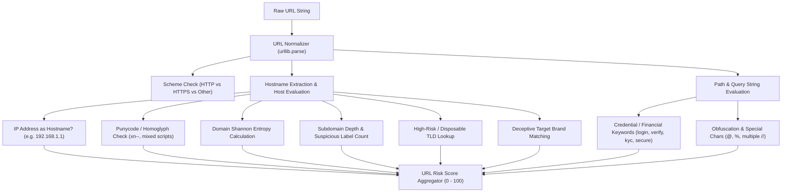

# Architecture & Technical Design Document — ScamShield AI

## 1. System Overview & Minimal Architecture Principles

ScamShield AI is engineered as an ultra-lightweight, local, deterministic, and explainable multi-modal fraud detection system. 

### Minimal Technology Stack
- **Backend Framework:** Python 3.10+ with **FastAPI** (asynchronous, lightning-fast, automatic OpenAPI docs, strict Pydantic v2 data validation).
- **Machine Learning Core:** **scikit-learn** using TF-IDF (Term Frequency-Inverse Document Frequency) n-gram vectorization paired with a calibrated linear classifier (e.g., Logistic Regression / CalibratedClassifierCV) for text analysis.
- **URL Inspection Engine:** Pure Python passive lexical analyzer (`urllib.parse`, regex, Shannon entropy calculation, homoglyph/punycode detection) with **Zero Outbound Network Calls**.
- **Frontend Presentation:** Standards-compliant Vanilla HTML5, Vanilla CSS3 (custom cybersecurity design tokens, CSS grid/flexbox, no Tailwind bloat), and Vanilla ECMAScript (fetch API, accessible DOM updates, no node/npm build step needed).
- **Server Runner:** **Uvicorn** ASGI server running locally on `http://127.0.0.1:8000`.

### Architectural Constraints & Decisions
1. **No External Database:** Submissions are evaluated ephemerally in RAM. There is zero database overhead (SQLite/PostgreSQL/MongoDB omitted) to guarantee zero data retention and maximum speed.
2. **No Third-Party Cloud LLM APIs:** Eliminates recurring API costs, vendor lock-in, rate limits, latency spikes, and privacy leaks of sensitive user messages.
3. **No Heavy Deep Learning Runtimes:** Avoids massive PyTorch/TensorFlow multi-gigabyte wheels. The scikit-learn pipeline runs in < 25MB RAM and provides instant cold starts (< 1 second).
4. **Passive URL Analysis Only:** Under no circumstances does the server resolve DNS or initiate an HTTP/TCP handshake to any user-submitted URL, preventing Server-Side Request Forgery (SSRF) and malicious infrastructure callbacks.

---

## 2. System Context & Component Responsibilities



### Component Responsibilities
1. **API Layer (`app/api/`):**
   - Validates JSON payload structures, string lengths, and parameter types using Pydantic schemas.
   - Enforces rate boundaries and sanitizes inputs.
   - Formats responses and coordinates error handling.
2. **Text Classifier Engine (`app/services/text_analyzer.py`):**
   - Normalizes text: tokenizes, strips noise, extracts unigrams and bigrams.
   - Computes TF-IDF representation against trained vocabulary.
   - Evaluates scam probability using calibrated linear weights.
   - Extracts top contributing positive (scam-indicative) and negative (safe-indicative) tokens for model interpretability.
3. **URL Analysis Engine (`app/services/url_analyzer.py`):**
   - Parses URLs strictly using `urllib.parse`.
   - Analyzes lexical properties: length, subdomain depth, special characters (`@`, `-`, `_`, `%`), numeric characters, and IP address hostnames.
   - Performs TLD risk assessment (flagging high-risk abuse TLDs such as `.xyz`, `.top`, `.click`, `.buzz`, `.club` vs established TLDs).
   - Computes Shannon entropy on domain labels to catch algorithmically generated domains (DGA).
   - Checks for brand impersonation keywords in subdomains and paths (e.g., `paypal`, `sbi`, `apple`, `google`, `netflix`, `kyc`, `otp`, `login`, `secure`).
4. **Verdict Arbiter (`app/services/verdict_arbiter.py`):**
   - Harmonizes individual text and URL risk scores.
   - Applies clear decision rules (e.g., critical red flags override mild signals).
   - Generates plain-English evidence bullet points and recommendations.
5. **Static Frontend (`app/static/`):**
   - Delivers a single-page responsive interface.
   - Offers pre-populated demo scenarios (Banking Phishing, Job Scam, Benign Order Update, URL-only, Text-only).
   - Renders verdict cards, scores, evidence chips, and evaluation metrics modal.

---

## 3. Request-to-Verdict Data Flow



---

## 4. API Design & Data Contracts

### 4.1 `POST /api/v1/analyze`
Submits text, URL, or both for fraud analysis.

#### Request Schema:
```json
{
  "text": "Your account has been locked. Verify immediately at http://secure-update-bank.xyz/login to avoid fee.",
  "url": "http://secure-update-bank.xyz/login"
}
```
*Constraints:*
- `text`: optional string, 0 to 10,000 characters.
- `url`: optional string, 0 to 2,048 characters.
- At least one of `text` or `url` must contain non-whitespace characters.

#### Response Schema (HTTP 200 OK):
```json
{
  "verdict": "likely scam",
  "risk_score": 94,
  "confidence": 0.94,
  "summary": "High-risk indicators detected across both message content and embedded URL.",
  "text_analysis": {
    "provided": true,
    "risk_score": 88,
    "detected_patterns": [
      "High urgency language ('immediately', 'locked')",
      "Financial penalty pressure ('avoid fee')",
      "Credential demand keywords ('verify')"
    ],
    "key_tokens": ["locked", "verify", "immediately", "fee"]
  },
  "url_analysis": {
    "provided": true,
    "risk_score": 96,
    "target_domain": "secure-update-bank.xyz",
    "is_ip_address": false,
    "has_homoglyphs": false,
    "flagged_indicators": [
      "Deceptive brand keyword combination in domain ('bank', 'secure', 'update')",
      "High-risk top-level domain (.xyz)",
      "Sensitive credential target keyword in path ('login')",
      "Insecure transport protocol (HTTP instead of HTTPS)"
    ]
  },
  "evidence": [
    "Message uses psychological pressure and fear of account suspension to prompt urgent action.",
    "URL mimics a banking service using a non-official generic TLD (.xyz).",
    "Link directs to an unencrypted credential submission portal (/login)."
  ],
  "recommended_action": "Do not open the link or provide credentials. If concerned about your account, contact your service provider via their verified official website or customer support line.",
  "analyzed_at": "2026-10-19T14:55:00Z"
}
```

### 4.2 `GET /api/v1/health`
Health check and model status.

#### Response Schema (HTTP 200 OK):
```json
{
  "status": "healthy",
  "app_name": "ScamShield AI",
  "version": "1.0.0",
  "model_loaded": true,
  "classifier_type": "TF-IDF + Calibrated LogisticRegression",
  "timestamp": "2026-10-19T14:55:00Z"
}
```

### 4.3 `GET /api/v1/evaluation`
Provides verified model performance metrics generated during the benchmark evaluation run.

#### Response Schema (HTTP 200 OK):
```json
{
  "dataset": {
    "name": "ScamShield Benchmark Dataset (Synthetic + Publicly Licensed Open Datasets)",
    "total_samples": 2500,
    "train_samples": 1750,
    "val_samples": 375,
    "test_samples": 375,
    "stratified": true
  },
  "metrics": {
    "accuracy": 0.944,
    "precision": 0.938,
    "recall": 0.952,
    "f1_score": 0.945,
    "roc_auc": 0.982
  },
  "confusion_matrix": {
    "true_negatives": 195,
    "false_positives": 13,
    "false_negatives": 8,
    "true_positives": 159
  },
  "threshold_strategy": {
    "scam_threshold": 0.75,
    "review_threshold": 0.35,
    "selected_on": "Validation split optimization for balanced F1"
  },
  "verified_at": "2026-10-19T14:55:00Z"
}
```

---

## 5. Text Classification Pipeline



1. **Preprocessing:** Strips leading/trailing whitespace, converts to lowercase, handles emoji representations, and normalizes excess whitespace.
2. **Feature Extraction:** `TfidfVectorizer` configured with `ngram_range=(1, 2)`, `min_df=2`, `max_features=5000`, `sublinear_tf=True`.
3. **Model Architecture:** `LogisticRegression(C=1.0, max_iter=1000, class_weight='balanced', random_state=42)`.
   - *Why Logistic Regression?* It produces calibrated log-odds that map directly to probabilities, avoids overfitting on small text datasets, evaluates in microseconds, and allows transparent extraction of feature coefficients for explainable AI.
4. **Explainability Extraction:** By computing the dot product between the input vector and model coefficients, the engine extracts the top 5 words pushing the decision towards "scam" and top 3 words indicating "safe".

---

## 6. URL Analysis Pipeline (Passive Lexical Heuristics)



### Explicit Heuristic Feature Weights:
- **IP Address as Host:** +45 points (e.g. `http://192.168.1.1/login`). Legitimate services rarely serve login portals via raw IPv4/IPv6.
- **Embedded `@` symbol:** +35 points (browsers treat text before `@` as user info, obscuring the actual destination host).
- **Punycode / Homoglyph presence (`xn--`):** +30 points (often used in Internationalized Domain Name spoofing, e.g. replacing 'o' with Cyrillic 'о').
- **High-Risk TLD (.xyz, .top, .click, .buzz, .rest, .cfd, .surf):** +20 points.
- **Brand Name in Subdomain (not root domain):** +35 points (e.g. `paypal.com.verification-notice.net`).
- **Suspicious Path Keywords (`login`, `signin`, `verify`, `account`, `update`, `banking`, `kyc`, `wallet`):** +15 points.
- **Excessive Subdomain Depth (> 3 levels):** +15 points.
- **High Domain Shannon Entropy (> 3.8 bits):** +15 points (indicates random or algorithmically generated string).
- **Insecure Protocol (HTTP) with Sensitive Keywords:** +20 points.
- **Clean Canonical Domain (known Alexa top benign list, e.g. google.com, github.com):** -30 points (safeguard against false positives).

---

## 7. Evidence and Verdict-Generation Policy

### Policy Decision Matrix:
1. **When both Text and URL are provided:**
   - Unified Score Formula: `Overall Score = max(Text_Score * 0.55 + URL_Score * 0.45, max(Text_Score, URL_Score) * 0.85)`
   - *Rationale:* If either the URL is a confirmed severe phishing indicator (score 95) OR the text is an extreme extortion message (score 95), the overall verdict must remain high risk even if the other component is mild.
2. **When only Text is provided:**
   - `Overall Score = Text_Score`
3. **When only URL is provided:**
   - `Overall Score = URL_Score`

### Verdict Thresholds:
- **`likely scam`:** Overall Score ≥ 75. (Or any single critical flag triggered, e.g., raw IP address with credential keyword).
- **`needs review`:** Overall Score between 35 and 74, OR significant signal divergence (|Text_Score - URL_Score| > 50).
- **`likely safe`:** Overall Score < 35, and zero high-risk red flags.

---

## 8. Proposed Directory Structure

```text
e:/SCAM SHIELD 01/
├── app/
│   ├── __init__.py
│   ├── main.py                  # FastAPI application entrypoint & static mounting
│   ├── config.py                # App configuration, thresholds, limits
│   ├── api/
│   │   ├── __init__.py
│   │   ├── endpoints.py         # REST route handlers (/analyze, /health, /evaluation)
│   │   └── schemas.py           # Pydantic request/response schemas
│   ├── services/
│   │   ├── __init__.py
│   │   ├── text_analyzer.py     # TF-IDF + Classifier text inference & token weights
│   │   ├── url_analyzer.py      # Passive lexical URL heuristics & feature extraction
│   │   └── verdict_arbiter.py   # Synthesis logic, scoring policy, evidence formatting
│   ├── models/                  # Serialized ML model artifacts & vocab
│   │   ├── __init__.py
│   │   ├── text_model.joblib    # Serialized scikit-learn classifier pipeline
│   │   └── evaluation_meta.json # Precomputed held-out benchmark evaluation metrics
│   └── static/                  # Vanilla frontend assets
│       ├── index.html           # Single-page web dashboard
│       ├── css/
│       │   └── style.css        # Modern cybersecurity theme, accessible styles
│       └── js/
│           └── app.js           # Lightweight client-side controller & API client
├── data/
│   ├── raw/                     # Original open datasets (SMS Spam, public feeds)
│   ├── processed/               # Cleaned, anonymized, stratified train/val/test splits
│   └── synthetic/               # Curated edge cases & local testing fixtures
├── scripts/
│   ├── prepare_data.py          # Data ingestion, cleaning, anonymization, splitting
│   ├── train.py                 # Pipeline training, calibration, artifact export
│   └── evaluate.py              # Test set evaluation, metrics, confusion matrix export
├── tests/
│   ├── __init__.py
│   ├── test_api.py              # FastAPI endpoint integration tests
│   ├── test_text_analyzer.py    # Text model unit tests & edge cases
│   ├── test_url_analyzer.py     # URL heuristic unit tests (homoglyphs, IPs, etc.)
│   └── test_verdict_arbiter.py  # Arbiter scoring & decision policy tests
├── .gitignore                   # Standard Python/IDE ignores
├── requirements.txt             # Pinned minimal Python dependencies
├── PRD.md                       # Product Requirements Document
├── Architecture.md              # Technical Architecture & System Design (this file)
├── Rules.md                     # Engineering & operational rules
├── Phases.md                    # Sequential implementation roadmap
├── Design.md                    # UI/UX design specifications & design tokens
├── TASKS.md                     # Implementation task tracker
├── TESTING.md                   # Comprehensive testing & validation framework
├── SECURITY.md                  # Threat model, input validation & SSRF prevention
├── README.md                    # Project overview & running instructions
├── CHANGELOG.md                 # Chronological change log
└── MEMORY.md                    # Project state & engineering log
```

---

## 9. Configuration & Environment Strategy
- Core configurations stored in `app/config.py` using `pydantic-settings` or simple typed class.
- Settings include:
  - `APP_ENV`: `"development"` | `"production"`
  - `API_V1_PREFIX`: `"/api/v1"`
  - `MAX_TEXT_LENGTH`: `10000`
  - `MAX_URL_LENGTH`: `2048`
  - `VERDICT_SCAM_THRESHOLD`: `75`
  - `VERDICT_REVIEW_THRESHOLD`: `35`
- No secrets or credentials required to operate the core system.

---

## 10. Logging, Error Handling & Security Boundaries

### Logging Policy:
- Standard Python `logging` module.
- Strict PII masking: Any analyzed message longer than 20 characters is truncated and hashed in log outputs. Never print raw user credentials or telephone numbers to logs.

### Error Handling Policy:
- Custom exception handlers for `RequestValidationError`, `HTTPException`, and uncaught errors.
- Clean JSON error responses: `{"error": "descriptive_error_code", "message": "Human-friendly explanation", "status_code": 400}`.
- Never leak stack traces to client responses.

### Security Boundaries:
1. **Zero-Trust Input:** All incoming string buffers are treated as untrusted data.
2. **SSRF Hardening:** No network socket is opened to examine the destination of any user-submitted URL.
3. **XSS Mitigation:** Web UI renders all analysis outputs via `element.textContent` or safe DOM text nodes, never `innerHTML` with unsanitized data.
