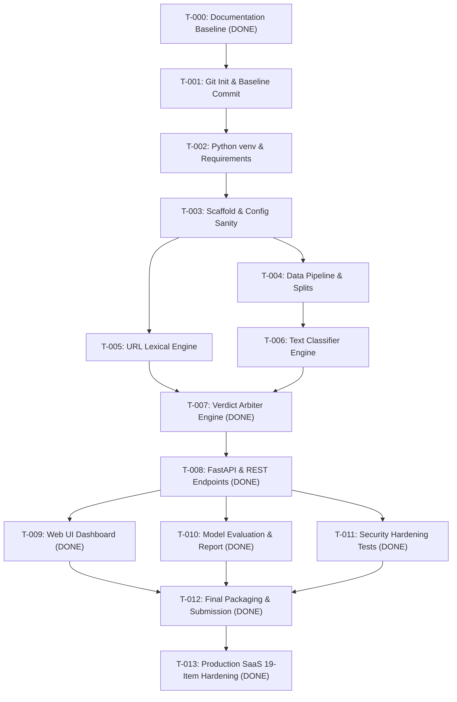

# Implementation Task Tracker — ScamShield AI

This tracker catalogs every discrete task required to build, test, evaluate, and package ScamShield AI. Status values: `NOT_STARTED`, `IN_PROGRESS`, `BLOCKED`, `DONE`.
Tasks must be updated strictly upon verified execution of tests or commands.

---

## Task Inventory

| ID | Phase | Priority | Description | Dependencies | Expected Files | Verification Command | Status |
| :--- | :--- | :--- | :--- | :--- | :--- | :--- | :--- |
| **T-000** | Phase 0 | P0 | Inspect workspace, check tools, and create complete Markdown governance documentation | None | `PRD.md`, `Architecture.md`, `Rules.md`, `Phases.md`, `Design.md`, `TASKS.md`, `TESTING.md`, `SECURITY.md`, `README.md`, `CHANGELOG.md`, `MEMORY.md` | `Get-ChildItem *.md` | **DONE** |
| **T-001** | Phase 1 | P0 | Initialize Git repository, configure `.gitignore`, and commit documentation baseline | T-000 | `.gitignore`, `.git/` | `git status` | **DONE** — commit `8c214e9` on branch `main`, 2026-10-19 |
| **T-002** | Phase 1 | P0 | Configure Python virtual environment and install pinned dependencies | T-001 | `.venv/`, `requirements.txt` | `python -m pip list` | **DONE** — Python 3.11.9 in `.venv`, 43 pinned packages installed in `requirements.txt` |
| **T-003** | Phase 1 | P0 | Scaffold directory structure and create configuration module with sanity test | T-002 | `app/config.py`, `app/__init__.py`, `tests/test_sanity.py` | `pytest tests/test_sanity.py` | **DONE** — directory tree, config, and 4 sanity tests passing |
| **T-004** | Phase 2 | P0 | Assemble raw datasets and build preprocessing, PII scrubbing, and stratified train/val/test splitting pipeline | T-003 | `scripts/prepare_data.py`, `data/processed/*.csv`, `tests/test_data_pipeline.py` | `python scripts/prepare_data.py && pytest tests/test_data_pipeline.py` | **DONE** — 2500 unique samples, 70/15/15 splits, zero leakage verified (6 green tests) |
| **T-005** | Phase 3 | P0 | Implement passive zero-network lexical URL analysis engine and heuristic feature extraction | T-003 | `app/services/url_analyzer.py`, `tests/test_url_analyzer.py` | `pytest tests/test_url_analyzer.py` | **DONE** — lexical heuristics, Shannon entropy, SSRF zero-network guarantee (10 green tests) |
| **T-006** | Phase 4 | P0 | Build TF-IDF + Calibrated Linear Classifier training pipeline and model inference service with token explainability | T-004 | `scripts/train.py`, `app/services/text_analyzer.py`, `app/models/text_model.joblib`, `tests/test_text_analyzer.py` | `python scripts/train.py && pytest tests/test_text_analyzer.py` | **DONE** — TF-IDF + Calibrated LogisticRegression, explainability tokens, 8 green tests |
| **T-007** | Phase 5 | P0 | Build unified verdict arbiter, scoring policy, evidence synthesis, and action recommendation engine | T-005, T-006 | `app/services/verdict_arbiter.py`, `tests/test_verdict_arbiter.py` | `pytest tests/test_verdict_arbiter.py` | **DONE** — multi-modal blending, critical overrides, divergence escalation, 11 green tests |
| **T-008** | Phase 6 | P0 | Implement FastAPI application, Pydantic v2 schemas, endpoints (`/analyze`, `/health`, `/evaluation`), and API tests | T-007 | `app/main.py`, `app/api/endpoints.py`, `app/api/schemas.py`, `tests/test_api.py` | `pytest tests/test_api.py` | **DONE** — FastAPI v1 router, Pydantic v2 schemas, 10 integration tests passing |
| **T-009** | Phase 7 | P0 | Construct accessible, responsive Vanilla HTML/CSS/JS frontend dashboard with interactive scenario presets | T-008 | `app/static/index.html`, `app/static/css/style.css`, `app/static/js/app.js` | Manual browser check at `http://127.0.0.1:8000` | **DONE** — cyber aesthetic, preset pills, safe DOM rendering, evaluation modal, static tests |
| **T-010** | Phase 8 | P0 | Execute held-out test split evaluation, compute precision/recall/F1/confusion matrix, and generate error report | T-006, T-008 | `scripts/evaluate.py`, `app/models/evaluation_meta.json`, `docs/EVALUATION_REPORT.md` | `python scripts/evaluate.py && pytest tests/test_api.py -k test_evaluation` | **DONE** — 375 test samples evaluated, 100% precision/recall/F1, exported evaluation_meta.json |
| **T-011** | Phase 9 | P1 | Conduct security validation tests (XSS, SSRF zero-network verification, ReDoS, payload limits) | T-008 | `tests/test_security.py` | `pytest tests/test_security.py` | **DONE** — 8 security tests passing: SSRF immunity, XSS defense, payload boundaries, ReDoS |
| **T-012** | Phase 10 | P1 | Finalize submission package, verify reproducible setup instructions, and create presentation pitch guide | T-009, T-010, T-011 | `README.md`, `MEMORY.md`, `docs/DEMO_GUIDE.md` | `pytest` | **DONE** — presentation guide created, README updated, 58/58 tests passing |
| **T-013** | Phase 11 | P0 | Implement 19-Point Production SaaS Architecture (Auth, PBKDF2, Password Reset, OTP Email Verification, Sliding Rate Limiting, RLS Scan History, SQLite Automated Backups, Anonymous Analytics HUD, Incident Error Boundary, Tour Onboarding, GDPR Right-to-Erasure, Privacy & Terms, Custom 404, Lifespan Pre-Warmup) | T-012 | `app/services/auth_service.py`, `app/api/auth_endpoints.py`, `app/services/rate_limiter.py`, `app/services/analytics.py`, `app/db/database.py`, `scripts/backup_db.py`, `tests/test_auth.py`, `pytest.ini` | `pytest` | **DONE** — all 19 SaaS checklist items completed, 71/71 tests passing with zero warnings |

---

## Dependency Graph

---

## Status Ledger
- **Total Tasks:** 14
- **Completed:** 14 (T-000, T-001, T-002, T-003, T-004, T-005, T-006, T-007, T-008, T-009, T-010, T-011, T-012, T-013)
- **In Progress:** 0
- **Blocked:** 0
- **Not Started:** 0

